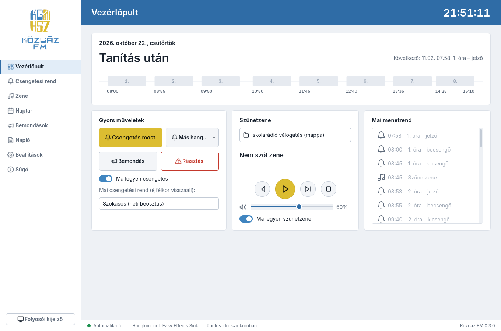
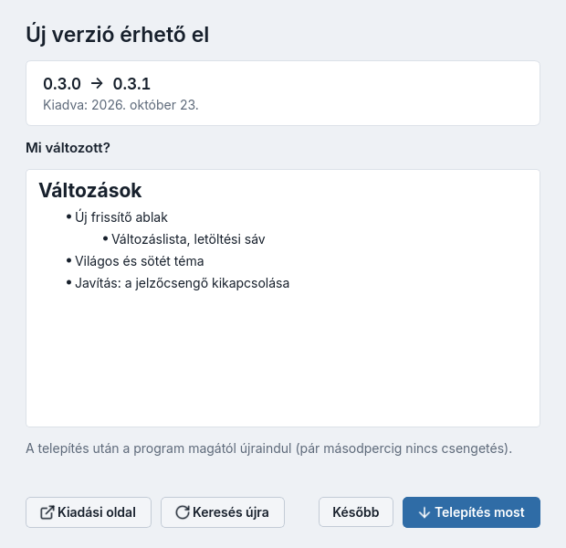
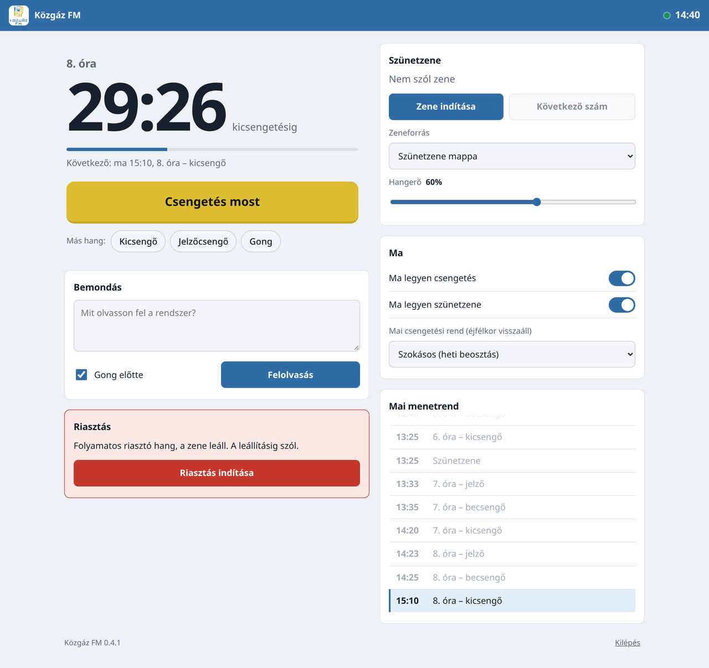

<p align="center"></p>

# Közgáz FM

Iskolai csengetőrendszer és szünetzene-lejátszó. A csengetési rend szerint magától csenget, a szünetekben
zenét játszik helyi MP3-ból, YouTube-ról vagy Spotifyról, és hangosbemondásra is képes.



## Funkciók

- **Automatikus csengetés:** becsengő, kicsengő, jelzőcsengő (X perccel előtte), több csengetési rend
  (Normál, Rövidített…), heti beosztás, rend-generátor.
- **Szünetzene:** mappa, MP3-fájlok / .m3u, YouTube (link, lista vagy keresés), Spotify (Premium, Web API).
  Csak a megadott hossznál hosszabb szünetekben, elhalkítással leáll a csengő előtt, reggeli zene.
- **YouTube előletöltés:** a következő számok gyorsítótárba kerülnek – akadásmentes, rövid netkiesésnél is szól.
- **Naptár:** szünnapok, tanítási szünetek, magyar ünnepnapok egy gombbal, kivételnapok.
- **Bemondás:** azonnali vagy ütemezett, felolvasott szöveg (TTS) vagy hangfájl, gonggal; a zene közben
  lehalkul.
- **Riasztás:** folyamatos riasztó hang egy gombbal, megerősítéssel.
- **Mai kapcsolók:** ma nincs csengetés / ma nincs zene / mai rend (pl. rövidített órák).
- **Folyosói kijelző:** teljes képernyős óra, visszaszámláló, épp szóló szám (F11).
- **Működés:** tálcán fut, automatikus indítás, egyetlen példány, hangkimenet-választás, napló,
  beállítás-export/import, beépített súgó, óraszinkron-figyelés.
- **Saját hangok:** saját csengőhang, dallam, jingle bemásolva a program mappájába; hiányzó hang helyett a
  beépített szól.
- **Átúsztatás:** a szünetzene számai egymásba úsznak (állítható, csengőnél azonnal elhallgat).
- **PIN-kód:** a beállító oldalak rendszergazda-PIN-nel zárhatók, a Vezérlőpult szabadon használható marad.
- **Webes vezérlés telefonról:** csengetés, zene, bemondás, mai kapcsolók és riasztás böngészőből az iskolai
  hálózaton, jelszóval; minden webes művelet naplózva.
- **Világos és sötét téma**, a mai nap idővonala a Vezérlőpulton.
- **Automatikus frissítés a GitHubról:** saját frissítő ablak változáslistával; csak tanítási időn kívül
  települ magától, SHA-256-tal ellenőrzött csomagból (Windows-telepítő, Linux-csomag és a Pi is).



- **Közgáz FM OS:** saját Raspberry Pi rendszer – bekapcsolás után kioszk módban indul, VNC-n távolról
  kezelhető, Spotify Connect hangszóró, hardveres watchdog és lefagyás-figyelő. Leírás: [pi-os/OLVASS-EL.md](pi-os/OLVASS-EL.md).

## Telepítés

- **Windows:** `KozgazFM-<verzió>-telepito.exe` a Releases oldalról (rendszergazdai jog nem kell).
- **Linux:** `tar xzf KozgazFM-<verzió>-linux-x86_64.tar.gz && ./KozgazFM-*/telepites.sh`
- **Raspberry Pi:** `KozgazFM-OS-<verzió>-arm64.img.xz` Raspberry Pi Imagerrel SD-kártyára.

## Fejlesztés

```bash
uv venv -p 3.14 && uv pip install -e ".[dev]"
.venv/bin/python -m kozgaz_fm
.venv/bin/pytest -q
.venv/bin/pyinstaller --noconfirm packaging/kozgaz-fm.spec
```

A beépített csengőhangokat az `eszkozok/hangok.py` generálja, a felület képernyőképeit az
`eszkozok/kepernyokep.py` készíti. A kiadást a `v*` tag indítja (GitHub Actions: Windows-telepítő,
Linux-csomag, wheel és Pi-lemezkép). A Pi-kép helyben: `pi-os/epit.sh`.

Használati útmutató: [src/kozgaz_fm/sugo.md](src/kozgaz_fm/sugo.md) (a programban a *Súgó* oldalon is).
