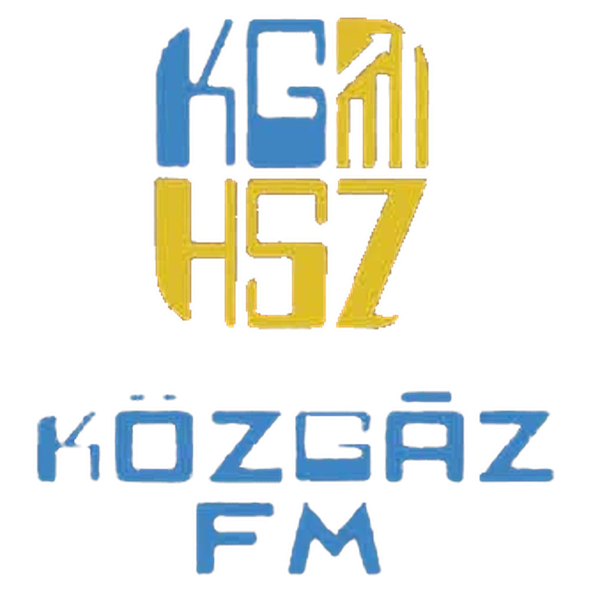
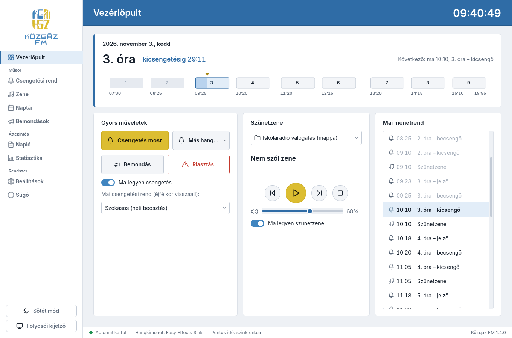
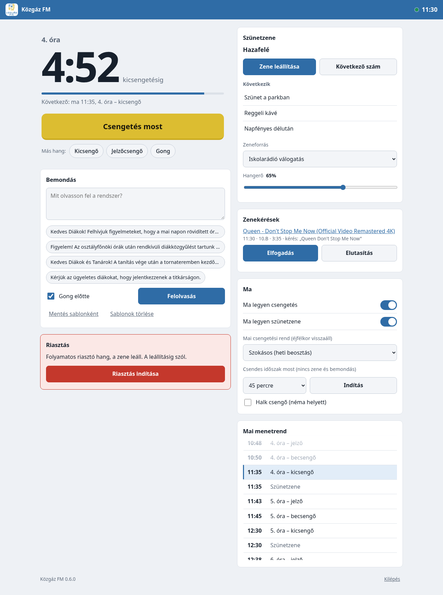
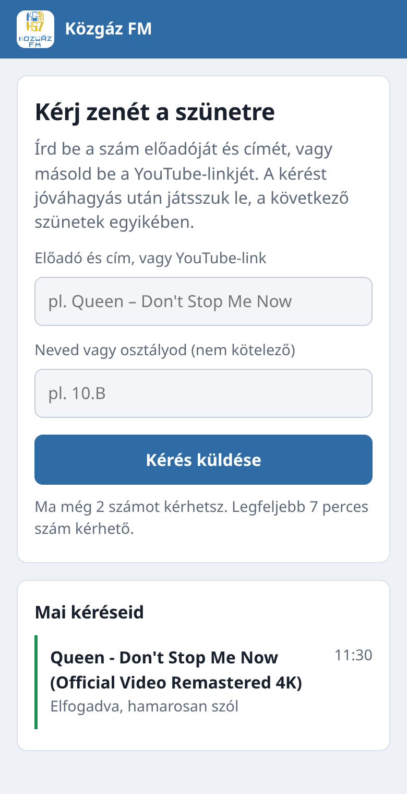
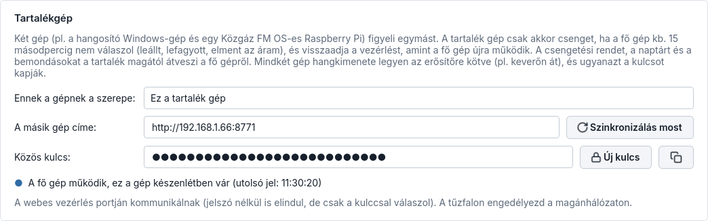
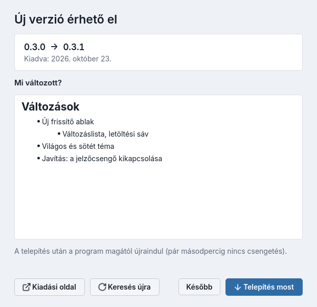

<p align="center"></p>

# Közgáz FM

Iskolai csengetőrendszer és szünetzene-lejátszó. A csengetési rend szerint magától csenget, a szünetekben
zenét játszik helyi MP3-ból, YouTube-ról vagy Spotifyról, és hangosbemondásra is képes.



## Funkciók

- **Automatikus csengetés:** becsengő, kicsengő, jelzőcsengő (X perccel előtte), több csengetési rend
  (Normál, Rövidített…), heti beosztás, rend-generátor.
- **Szünetzene:** mappa, MP3-fájlok / .m3u, YouTube (link, lista vagy keresés), Spotify (Premium, Web API).
  Csak a megadott hossznál hosszabb szünetekben, elhalkítással leáll a csengő előtt, reggeli zene.
- **YouTube előletöltés:** a következő számok gyorsítótárba kerülnek – akadásmentes, rövid netkiesésnél is szól.
- **Naptár:** szünnapok, tanítási szünetek, magyar ünnepnapok egy gombbal, kivételnapok.
- **Bemondás:** azonnali vagy ütemezett, felolvasott szöveg (TTS) vagy hangfájl, gonggal; a zene közben
  lehalkul.
- **Riasztás:** folyamatos riasztó hang egy gombbal, megerősítéssel.
- **Mai kapcsolók:** ma nincs csengetés / ma nincs zene / mai rend (pl. rövidített órák).
- **Folyosói kijelző:** teljes képernyős óra, visszaszámláló, épp szóló szám, a zenekérés QR-kódja (F11).
- **Működés:** tálcán fut, automatikus indítás, egyetlen példány, hangkimenet-választás, napló,
  beállítás-export/import, beépített súgó, óraszinkron-figyelés.
- **Saját hangok:** saját csengőhang, dallam, jingle bemásolva a program mappájába; hiányzó hang helyett a
  beépített szól.
- **Átúsztatás:** a szünetzene számai egymásba úsznak (állítható, csengőnél azonnal elhallgat).
- **PIN-kód:** a beállító oldalak rendszergazda-PIN-nel zárhatók, a Vezérlőpult szabadon használható marad.
- **Rendkívüli események:** előre beállított tűzriadó-gyakorlat (magától indul és leáll), rendkívüli
  csengetés (pl. ünnepség kezdete) és csendes időszak (érettségi, mérés: nincs zene és bemondás, a csengő
  néma vagy halk).
- **Webes vezérlés telefonról:** csengetés, zene (a következő számok listájával, ugrással), bemondás
  szerkeszthető sablonokkal, mai kapcsolók, csendes időszak egy gombbal és riasztás böngészőből az iskolai
  hálózaton, jelszóval; a telefon kezdőképernyőjére is kitehető. Minden webes művelet naplózva.
- **Zenekérés QR-kóddal, automatikusan:** a diák beolvassa a QR-kódot, beírja a számot (vagy egy szám saját
  QR-kódját olvassa be), és ha a szám átmegy az ellenőrzésen, magától a szünetzene következő helyére kerül.
  Amit nem sikerül ellenőrizni, az a rendszergazdához kerül jóváhagyásra. Napi korlát telefononként,
  hosszkorlát, tiltólista, duplikátum-szűrés; a jóváhagyás kérése egy kapcsolóval visszaállítható.
- **Tartalékgép:** két gép (pl. a hangosító Windows-gép és egy Pi) figyeli egymást; ha a fő gép kiesik, a
  tartalék kb. 15 másodpercen belül átveszi a csengetést, és visszaadja, amint a fő gép újra működik. A
  csengetési rendet és a naptárt a tartalék magától átveszi.
- **Hangerő-kiegyenlítés:** minden szám ugyanolyan hangosan szól (EBU R128 mérés ffmpeg-gel, egyszer, a
  háttérben); a csengő- és riasztóhangok hangereje nem változik.
- **Statisztika:** mi szólt, hányszor, mennyi kért szám, mennyire pontosak a csengetések; napi zeneidő,
  toplista, CSV-export (pl. jogdíj-elszámoláshoz), heti összefoglaló a webpanelen.
- **Tanév rendje importálása:** az iskola naptára (.ics fájl vagy Google Naptár/webcal link) egy kattintással:
  szünetek szünnapként, rövidített és szombati munkanapok kivételnapként, előnézettel.
- **Hangzónák:** több hangkimenet (pl. folyosó, udvar, tanári), zónánként kapcsolható csengő, zene és
  bemondás, külön hangerővel; a riasztás mindig mindenhol szól.
- **Értesítés a rendszergazdának:** ntfy (telefon) vagy e-mail, ha kimaradt egy csengetés, hiba van, eltűnt
  a hangkimenet, riasztás indult vagy a tartalékgép átvette a csengetést; reggeli önteszt tanítási napokon.
- **Műsorblokkok:** szünetenként és naponként más zeneforrás, a szünet sorszáma szerint (rövidített napon is).
- **Szűrő:** trágár szavak (a csillagozott és számokkal írt alakok is), „Explicit” jelölés, saját tiltólista,
  korhatáros YouTube-videók kihagyása.
- **Moderálás:** a most szóló szám egy gombbal letiltható, a kért szám levehető a sorból, a visszaélő telefon egy
  hétre kizárható, a programból és a webpanelről is.
- **Dalszöveg-szűrő:** letölti a szám szövegét, pontozza a trágár szavakat, és a nagyon trágár számot kiveszi a
  sorból; három érzékenységi fokozat, MP3-ra, YouTube-ra, Spotifyra és a kért számokra is érvényes.
- **Világos és sötét téma**, a mai nap idővonala a Vezérlőpulton.
- **Automatikus frissítés a GitHubról:** saját frissítő ablak változáslistával; csak tanítási időn kívül
  települ magától, SHA-256-tal ellenőrzött csomagból (Windows-telepítő, Linux-csomag és a Pi is).
- **Közgáz FM OS:** saját Raspberry Pi rendszer – bekapcsolás után kioszk módban indul, VNC-n távolról
  kezelhető, Spotify Connect hangszóró, hardveres watchdog és lefagyás-figyelő. Leírás: [pi-os/OLVASS-EL.md](pi-os/OLVASS-EL.md).

### Webes vezérlés és zenekérés

<p>
  
  
</p>

### Tartalékgép



### Frissítés



## Hogyan működik a dalszöveg-szűrő

1. A cím megtisztítása: a program leveszi a „(Official Video)”, „ft. …” és hasonló toldalékokat, és szétválasztja az
   előadót és a számot.
2. Dalszöveg-keresés az [LRCLIB](https://lrclib.net) nyilvános API-ján. Csak a szám címe és a diák által beírt keresőszó
   megy ki, a diák neve és a telefonja nem. Egy találat csak akkor számít, ha a cím, az előadó és a hossz is illik. Több
   változat (pl. rádiós és eredeti) közül a legtrágárabb dönt.
3. Pontozás: az erős szavak 5, a közepesek 3, az enyhék 1 pontot érnek. A program felismeri a toldalékos, ékezet
   nélküli, csillagozott és számokkal írt alakokat (`f*ck`, `sh1t`, `kurvára`), a hasonló ártatlan szavakat viszont nem
   bántja (`szarvas`, `baszk`, `pocsolya`).
4. Döntés: a szám trágár, ha elér egy adott számú erős szót, vagy túllép egy pontsűrűséget (pont / 100 szó).

| Érzékenység | Erős szó legfeljebb | Pontsűrűség legfeljebb |
| --- | --- | --- |
| Szigorú | 1 | 3 alatt |
| Normál (alap) | 4 | 5 alatt |
| Laza | 14 | 20 alatt |

Az eredményeket a program a gépen tárolja (csak a pontokat, a dalszöveget nem), ezért egy számot csak egyszer kérdez le.

**Korlátok.** Ez nem tökéletes szűrő. A szolgáltatás sok magyar számot nem ismer, és néha túlterhelt. Ha nincs meg a
szöveg, a saját listákban lévő szám a cím- és a korhatár-szűrés után lejátszható, a kért szám viszont nem kerül be
magától, hanem jóváhagyásra vár. A program azt vizsgálja, amit a videó címe állít: egy félrecímkézett videót nem
ismer fel. Az enyhén káromkodó szám normál fokozaton átmehet.

## Zenekérés API

A QR-kód a `http://<gép>:8080/keres` oldalra visz. Egy adott számot így lehet egyből kérni (ezt tartalmazza *A szám
QR-kódja* gombbal készült kód is), a telefon megnyitáskor rögtön elküldi a kérést:

```
http://<gép>:8080/keres?szam=Queen%20Don't%20Stop%20Me%20Now
```

Saját felületből az API is hívható, bejelentkezés nélkül, az iskolai hálózaton. A készüléket a `kfm_eszkoz` süti
azonosítja, ezt az első válasz állítja be:

```
GET  /api/v1/zenekeres    a kérés-oldal állapota és a saját mai kérések
POST /api/v1/zenekeres    {"szoveg": "Előadó – cím vagy YouTube-link", "nev": "10.B"}
```

A `POST` kéréshez `X-Kozgaz-FM: 1` fejléc kell. A kérés állapota a válaszban és a `GET` hívással követhető: `kereses`,
`varakozik`, `elfogadva`, `szol`, `elutasitva` (az `ok` mezőben az indokkal).

## Újdonságok az 1.2.0-ban

- Moderálás a programban és a webpanelen: a most szóló szám tiltása egy gombbal, kért szám levétele a sorból, telefon
  kizárása egy hétre, mindez feloldható és naplózva van.
- A letiltott szám minden forrásból kimarad (más feltöltésben is, ha a címe ugyanaz), és nem kérhető újra.

## Újdonságok az 1.1-ben

- Dalszöveg-szűrő: a nagyon trágár számok kiszűrése a szöveg pontozásával, három érzékenységgel, minden forrásra.
- Automatikus zenekérés: a QR-kóddal kért, ellenőrzött szám jóváhagyás nélkül a sorba kerül (kikapcsolható).
- Egy konkrét szám saját QR-kódja: beolvasásra rögtön elküldi a kérést.
- A cím-szűrő a csillagozott és számokkal írt trágár szavakat is felismeri.
- Ami nemrég szólt, azt egy ideig nem lehet újra kérni.

## Újdonságok az 1.0.0-ban

Az első stabil kiadás: a 0.x sorozat minden funkciója (csengetés, szünetzene, bemondás, naptár, webes
vezérlés, zenekérés, tartalékgép, hangzónák, értesítések, statisztika) kipróbálva, egy csomagban.

## Újdonságok a 0.10.0-ban

- Műsorblokkok: szünetenként és naponként más zeneforrás (pl. reggel nyugodt lista, nagyszünetben slágerek,
  pénteken buli-lista); a program forrásonként megjegyzi, hol tartott.
- Szűrő: beépített trágárszó-lista és „Explicit” jelölés, saját tiltólista (egész szó vagy szókezdet), korhatáros
  YouTube-videók kihagyása; a zenekérésre és a Spotifyra is érvényes.

## Újdonságok a 0.9.1-ben

- Hangzónák: több hangkimenet egyszerre, zónánként csengő / zene / bemondás és hangerő, próbahang zónánként.
- A felolvasott bemondás eSpeak NG-vel a kiválasztott zónákban szól.

## Újdonságok a 0.8.0-ban

- Értesítések a rendszergazdának telefonra (ntfy) vagy e-mailben: kimaradt csengetés, hibák, eltűnt
  hangkimenet, riasztás, tartalékgép-átvétel, a program újraindulása.
- Reggeli önteszt tanítási napokon: mai rend, hangkimenet, zeneforrás, tegnapi pontosság, frissítés.

## Újdonságok a 0.7.0-ban

- Hangerő-kiegyenlítés: nincs többé túl halk vagy túl hangos szám a folyosón.
- Statisztika oldal: zeneidő, toplista, kért számok, csengetési pontosság, CSV-export; heti összefoglaló a
  webpanelen.
- Tanév rendje importálása .ics fájlból vagy naptárlinkről, előnézettel.
- A párbeszédablakok gombjai magyarul jelennek meg (Mégse, Igen, Nem).

## Újdonságok a 0.6.0-ban

- Rendkívüli események a Naptárban: tűzriadó-gyakorlat, rendkívüli csengetés, csendes időszak.
- Zenekérés diákoktól QR-kóddal, jóváhagyással.
- Tartalékgép: automatikus átvétel és visszaadás, beállítás-szinkron.
- Webpanel: zenesor és ugrás, bemondás-sablonok (a programmal közösek), csendes időszak telefonról, telepíthető ikon.
- A dalcímek mindenhol sima szövegként jelennek meg; a kért számok keresése csak a YouTube-on fut.

## Telepítés

- **Windows:** `KozgazFM-<verzió>-telepito.exe` a Releases oldalról (rendszergazdai jog nem kell).
- **Linux:** `tar xzf KozgazFM-<verzió>-linux-x86_64.tar.gz && ./KozgazFM-*/telepites.sh`
- **Raspberry Pi:** `KozgazFM-OS-<verzió>-arm64.img.xz` Raspberry Pi Imagerrel SD-kártyára.

A már telepített példányok az önfrissítővel maguktól megkapják az új verziót (tanítási időn kívül).

## Fejlesztés

```bash
uv venv -p 3.14 && uv pip install -e ".[dev]"
.venv/bin/python -m kozgaz_fm
.venv/bin/pytest -q
.venv/bin/pyinstaller --noconfirm packaging/kozgaz-fm.spec
```

A beépített csengőhangokat az `eszkozok/hangok.py` generálja, a felület képernyőképeit az
`eszkozok/kepernyokep.py` készíti. A kiadást a `v*` tag indítja (GitHub Actions: Windows-telepítő,
Linux-csomag, wheel és Pi-lemezkép). A Pi-kép helyben: `pi-os/epit.sh`.

Használati útmutató: [src/kozgaz_fm/sugo.md](src/kozgaz_fm/sugo.md) (a programban a *Súgó* oldalon is).
